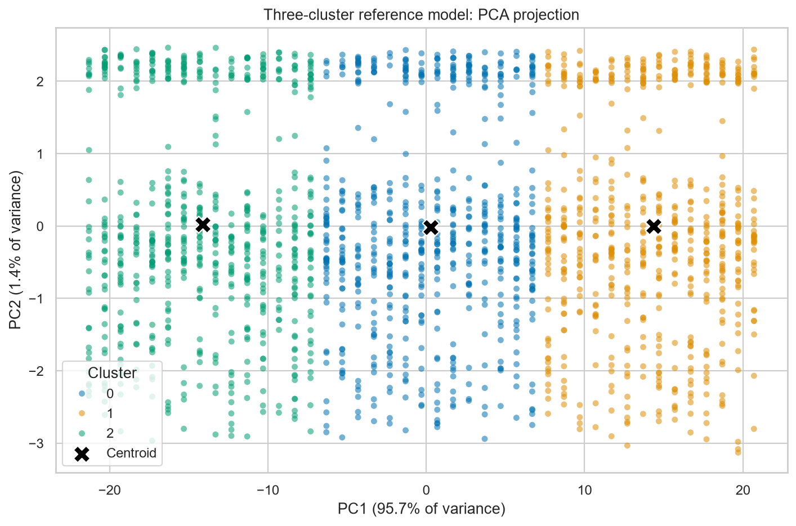
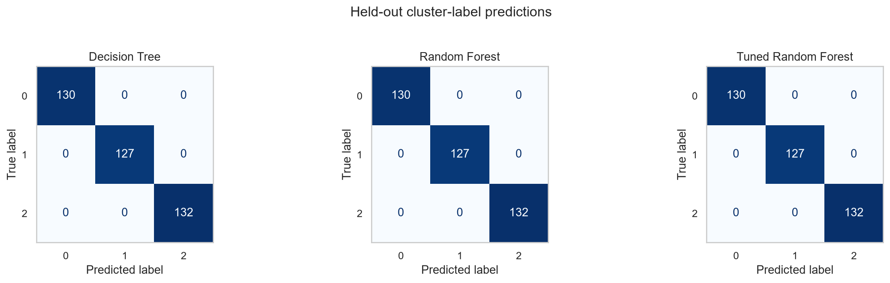

# Bank Transaction Clustering & Classification

A documented, reproducible study of transaction segmentation and supervised prediction of cluster assignments.

**Author:** Muhammad Akhtar Ariq

This portfolio edition refactors a BMLP final project into two executable analysis notebooks. It replaces the exercise scaffolding with validated inputs, documented transformations, reproducible experiments, complete classifier pipelines, and exported evaluation evidence. Original submissions remain available in Git history.

## What the project investigates

The workflow explores bank transaction data, fits K-Means clusters, interprets those groups in original feature units, and compares classifiers that learn their assignments. **`Target` is a generated cluster label, not a verified fraud outcome.**

The executed analysis reads **2,537 source rows with 16 columns** and retains **1,945 records** after removing incomplete records, duplicates, and numerical outliers. The labeled exports contain ten features and one target column.

## Analysis notebooks

1. **[Transaction segmentation]([Clustering]_Submission_Akhir_BMLP_Muhammad_Akhtar_Ariq.ipynb)** — source validation, EDA, cleaning audit, feature engineering, cluster-count comparison, K-Means, PCA, cluster profiles, and artifact export.
2. **[Predicting cluster assignments]([Klasifikasi]_Submission_Akhir_BMLP_Muhammd_Akhtar_Ariq.ipynb)** — labeled-data validation, stratified train/test split, fitted preprocessing pipelines, model comparison, cross-validated tuning, confusion matrices, and serialization checks.

The existing filenames are retained so current links and editor references continue to work. All analysis prose and code have been rewritten in English.

## Methodology

- **Data preparation:** validate the declared schema; remove missing and duplicate records; explicitly exclude IDs, IP addresses, and timestamps; apply sequential 1.5 × IQR filtering; standardize numerical features; label-encode categorical features; and derive age tertiles.
- **Clustering:** compare 2–9 clusters using inertia and silhouette scores. Use `random_state=42` and ten initializations. Keep the three-cluster reference experiment while reporting that two clusters have the highest silhouette score.
- **Interpretation:** inspect PCA explained variance and loadings, use distinct cluster colors, restore numerical/category values, and export cluster counts and descriptive profiles.
- **Classification:** reserve 20% of rows with a stratified split (1,556 train / 389 test). A `ColumnTransformer` and `OneHotEncoder` are fitted inside each classifier pipeline, including during cross-validation.
- **Tuning:** evaluate 27 Random Forest parameter combinations using five shuffled stratified folds of the training data. Evaluate all models on the same held-out rows after the search.

## Results from the executed portfolio edition

The three-cluster reference silhouette score is **0.494688**. Two principal components retain **97.11%** of the prepared feature variance.

| Classifier | Test accuracy | Weighted F1 |
| --- | --- | --- |
| Decision Tree | 100.00% | 1.0000 |
| Random Forest | 100.00% | 1.0000 |
| Tuned Random Forest | 100.00% | 1.0000 |

Full-precision values are in [classification metrics](reports/classification_metrics.csv), with [per-class reports](reports/classification_reports.json) and [grid-search results](reports/grid_search_results.csv).

**Why perfect agreement is possible:** all 43 locations map to a single cluster in this run, and the Decision Tree assigns all of its impurity-based importance to location indicators. The original unscaled integer encoding of location strongly influences the clustering. These classifiers reproduce that category partition; the scores do not establish useful behavioral segmentation, fraud detection, or performance on future transactions.

The refactor explicitly uses ten K-Means initializations, full one-hot category blocks, and shuffled cross-validation. These choices can change labels and scores relative to the original submission; this table reports the newly executed experiment rather than reusing historical numbers.

## Selected outputs





Further figures include [cluster-count comparison](assets/kmeans-elbow.png), [feature correlations](assets/correlation-heatmap.png), [feature distributions](assets/numerical-distributions.png), [occupation comparison](assets/transaction-amount-by-occupation.png), and [model comparison](assets/classification-model-comparison.png).

Portfolio summary, short card text, and a suggested showcase order are in [PORTFOLIO.md](PORTFOLIO.md).

## Run the notebooks

Use Python 3.12 from the repository root:

```powershell
python -m venv .venv
.\.venv\Scripts\python -m pip install -r requirements.txt
.\.venv\Scripts\python -m jupyterlab
```

Select the project environment as the notebook kernel. Run the clustering notebook from top to bottom, then run classification. The first notebook downloads the [public course dataset](https://docs.google.com/spreadsheets/d/e/2PACX-1vTbg5WVW6W3c8SPNUGc3A3AL-AG32TPEQGpdzARfNICMsLFI0LQj0jporhsLCeVhkN5AoRsTkn08AYl/pub?output=csv). Classification can also run directly against the committed readable CSV.

Optional environment variables support offline inputs and isolated output directories:

```powershell
$env:BMLP_DATASET_PATH = 'C:/path/to/local-source.csv'
$env:BMLP_OUTPUT_DIR = 'C:/path/to/experiment-output'
```

Set these before launching Jupyter. Both notebooks use the same output directory, so classification reads the CSV produced by clustering. Without overrides, outputs are written into the repository and overwrite existing artifacts.

## Saved artifacts

| Artifact | Contents |
| --- | --- |
| `data_clustering.csv` | Encoded/scaled features and generated `Target` labels |
| `data_clustering_inverse.csv` | Readable feature values with the same aligned labels |
| `model_clustering.h5` | K-Means estimator fitted on prepared features |
| `PCA_model_clustering.h5` | Separate K-Means estimator fitted on the two PCA components |
| `clustering_preprocessing.joblib` | Scaler, categorical encoders, age-bin boundaries, and feature order |
| `pca_transformer.joblib` | Fitted two-component PCA transformer |
| `decision_tree_model.h5` | Complete fitted preprocessing + Decision Tree pipeline |
| `explore_RandomForest_classification.h5` | Complete fitted preprocessing + Random Forest pipeline |
| `tuning_classification.h5` | Fitted `GridSearchCV`, including its complete best pipeline |
| `reports/` | Cleaning audit, cluster profiles, metrics, split counts, search results, fingerprints, and version metadata |
| `assets/` | Seven regenerated figures used in the notebooks and portfolio |

**Format:** the legacy `.h5` files are Joblib-serialized scikit-learn objects, not HDF5/Keras models. Only load trusted artifacts. scikit-learn is pinned to 1.6.1; exact versions from the executed run are recorded in [clustering metadata](reports/clustering_metadata.json) and [classification metadata](reports/classification_metadata.json).

The classifiers now accept original feature units and category strings through their fitted pipelines:

```python
import joblib
import pandas as pd

model = joblib.load("tuning_classification.h5")
records = pd.read_csv("data_clustering_inverse.csv").drop(columns="Target")
predicted_clusters = model.predict(records.head())
```

This differs from the original bare classifier artifacts, which required manually encoded input columns. Clustering preprocessing state is saved for reproducibility; unseen categories, out-of-range ages, and anomaly handling still require a policy before applying the segmentation to new data.

## Validation

```powershell
.\.venv\Scripts\python -m unittest discover -s tests -v
```

The regression suite checks missing/invalid inputs, infinite values, outlier filtering, index preservation, reversible feature transforms, target-label validation, and hand-calculated classification metrics. Both notebooks have also been executed end to end. Classification verifies that reloaded serialized models reproduce their predictions. Notebook outputs contain no cell errors or warnings.

## Interpretation limits

- Clustering and its upstream preprocessing use the full dataset before classification splitting. This study evaluates reproduction of that fixed segmentation, not an independent end-to-end predictive workflow.
- Integer category encoding imposes artificial Euclidean distances. Location dependence and the dominant first PCA component show why a mixed-type representation should be investigated before operational use.
- Sequential outlier filtering is order-dependent; the zero IQR of `LoginAttempts` removes all values above one in this run. That can remove the very records a fraud study would need.
- Age tertiles repeat information already present in age. Cluster means do not establish customer value or technological proficiency.
- Row-level stratification does not enforce account separation or chronological validation. Neither stability under resampling nor a deployment API is included.

## Technologies and provenance

Python, pandas, NumPy, scikit-learn, Matplotlib, Seaborn, Joblib, and Jupyter Notebook/JupyterLab. Cluster-count diagnostics use scikit-learn directly; Yellowbrick is no longer required.

The source dataset is supplied through the BMLP course. The original course notebook instructions remain in Git history. No dataset/template redistribution license was supplied with the project; consult the original provider's terms for reuse.
