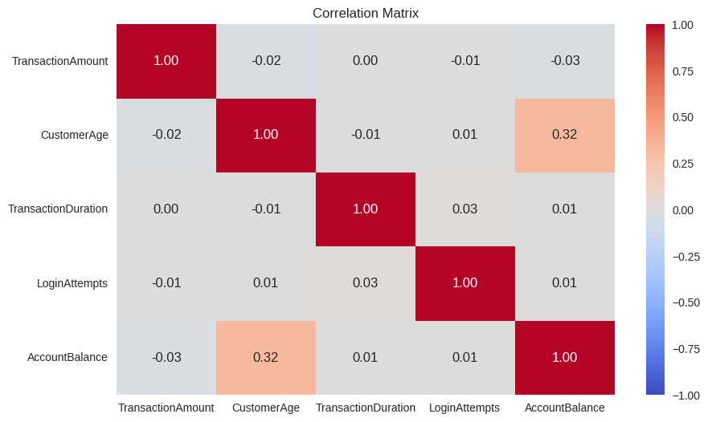
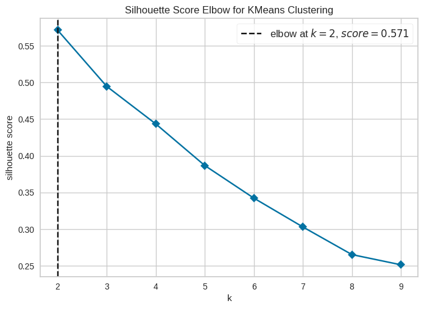

# Bank Transaction Clustering & Classification

An educational machine-learning project that segments bank transactions with K-Means and trains classifiers to predict the resulting cluster labels.

**Author:** Muhammad Akhtar Ariq

**Context:** Final BMLP (Belajar Machine Learning untuk Pemula) submission. The original Indonesian submission notebooks and their recorded outputs are preserved.

## Project overview

The workflow connects unsupervised and supervised learning: explore transaction data, clean and transform the features, discover three clusters, interpret them in their original units, and compare Decision Tree and Random Forest classifiers. The classification target is the cluster assignment generated by K-Means; it is not a verified fraud label.

The clustering notebook records **2,537 input rows and 16 columns**. After missing-value removal, deduplication, and IQR-based outlier filtering, the exported datasets contain **1,945 rows, 10 features, and one `Target` column**. Cluster sizes are 555, 690, and 700 for labels 0, 1, and 2 respectively.

## Workflow

1. **Explore:** descriptive statistics, a correlation heatmap, numerical distributions, and transaction amounts by customer occupation.
2. **Prepare:** remove incomplete and duplicate rows; drop identifiers, IP addresses, and date columns; encode categories; remove numerical outliers; standardize numerical features; and create age groups with quantile binning.
3. **Cluster:** inspect a silhouette-based cluster-count plot, fit K-Means with three clusters, calculate the silhouette score, and explore a two-component PCA representation and a separate K-Means model on PCA features.
4. **Interpret and export:** summarize clusters and inverse-transform numerical and categorical features into readable units.
5. **Classify:** one-hot encode the inverse-transformed dataset and use a stratified 80/20 train/test split (1,556 training rows and 389 test rows, `random_state=42`).
6. **Compare and tune:** evaluate Decision Tree and Random Forest models, then use five-fold `GridSearchCV` over 27 Random Forest parameter combinations.

## Recorded results

These values come from the notebooks' saved outputs, rather than a fresh training run.

| Experiment | Metric | Recorded value |
| --- | --- | --- |
| K-Means, three clusters | Silhouette score | 0.495976 |
| Decision Tree | Test accuracy | Approximately 95% |
| Random Forest, 100 trees | Test accuracy | Approximately 99% |
| Tuned Random Forest | Test accuracy | Approximately 99% |

Classification percentages are rounded as displayed by `classification_report`. Both Random Forest experiments report a weighted F1-score of 0.99. Tuning does not show an improvement in rounded test accuracy.

These scores measure agreement with **K-Means-generated labels**. Clustering and its preprocessing were fitted before the classification split, so this is a demonstration of reproducing the segmentation, not an independent estimate of fraud detection or future transaction performance.

## Selected visual outputs

### Feature relationships



### Comparing cluster counts



The saved Yellowbrick plot uses the silhouette metric and marks **two clusters** as the strongest candidate (about 0.571). The submitted final estimator uses **three clusters** (about 0.496); the notebook does not document a rationale for choosing three over the plot's suggestion.

Additional original figures and portfolio-ready copy are listed in [PORTFOLIO.md](PORTFOLIO.md). The images are extracted directly from executed notebook outputs, not from the template's example screenshots.

## Repository contents

| File | Purpose |
| --- | --- |
| `[Clustering]_Submission_Akhir_BMLP_Muhammad_Akhtar_Ariq.ipynb` | EDA, preprocessing, K-Means, PCA, cluster interpretation, and dataset export |
| `[Klasifikasi]_Submission_Akhir_BMLP_Muhammd_Akhtar_Ariq.ipynb` | Decision Tree, Random Forest, tuning, and classification reports |
| `data_clustering.csv` | Encoded/scaled features with cluster-derived `Target` labels |
| `data_clustering_inverse.csv` | Readable feature values with the same target labels; input to classification |
| `model_clustering.h5` | K-Means estimator fitted on the prepared features |
| `PCA_model_clustering.h5` | K-Means estimator fitted on two PCA components |
| `decision_tree_model.h5` | Trained Decision Tree classifier |
| `explore_RandomForest_classification.h5` | Trained baseline Random Forest classifier |
| `tuning_classification.h5` | Fitted Random Forest `GridSearchCV` object |
| `assets/` | Four original notebook figures for the README and portfolio |
| `requirements.txt` | Notebook runtime dependencies |
| `PORTFOLIO.md` | Summary, short card copy, technologies, and suggested showcase outputs |

The original classification notebook filename contains `Muhammd`; it is retained to preserve the submitted artifact.

## Run locally

Use Python 3.12. From the repository root:

```powershell
python -m venv .venv
.\.venv\Scripts\python -m pip install -r requirements.txt
.\.venv\Scripts\python -m jupyterlab
```

Open the clustering notebook and run its cells in order, then run the classification notebook. The clustering notebook downloads its input from the [public course dataset CSV](https://docs.google.com/spreadsheets/d/e/2PACX-1vTbg5WVW6W3c8SPNUGc3A3AL-AG32TPEQGpdzARfNICMsLFI0LQj0jporhsLCeVhkN5AoRsTkn08AYl/pub?output=csv), so it requires an internet connection. The classification notebook can use the committed `data_clustering_inverse.csv` directly. Run notebooks with the repository root as the working directory so relative paths resolve correctly.

Running the notebooks overwrites their generated CSV and model files. The dependency file pins scikit-learn to **1.6.1**, the version recorded in the saved model artifacts; it is not an exact lockfile of the original training environment.

## Model format and limitations

- The `.h5` files were written with **Joblib**. They are serialized scikit-learn objects, not HDF5, Keras, or TensorFlow models. Load trusted artifacts with `joblib.load(...)` in a compatible environment.
- The scaler, label encoders, fitted PCA transformer, and classifier feature schema are not saved as a complete inference pipeline. Recreate them by running the notebooks before applying the estimators to new records. `PCA_model_clustering.h5` contains the K-Means estimator, not the PCA transformer.
- Some categorical features, including location, are label-encoded and remain unscaled in K-Means. Their numeric codes can influence distances; cluster interpretations are exploratory. The differences between cluster means do not establish customer value or technology proficiency.
- The stored PCA scatter plot uses two palette colors for three clusters and emits a warning. Correct its palette before using that plot as a portfolio image. The four exported figures avoid this plot.
- This is a notebook-based coursework project. No deployed app, production inference API, or validated fraud detector is included.

## Technologies

Python, pandas, NumPy, scikit-learn, Matplotlib, Seaborn, Yellowbrick, Joblib, Jupyter Notebook, and Google Colab metadata. The methods include K-Means, PCA, Decision Trees, Random Forests, label encoding, one-hot encoding, standardization, IQR filtering, and cross-validated grid search.

## Data and attribution

The input is supplied by the course through the public CSV linked above. The raw source dataset is fetched by the notebook; the two derived CSV files are included as project outputs. The repository contains course-provided notebook instructions alongside the completed code. No dataset or template redistribution license is supplied in the project files; consult the original provider's terms before reusing them beyond this educational context.
